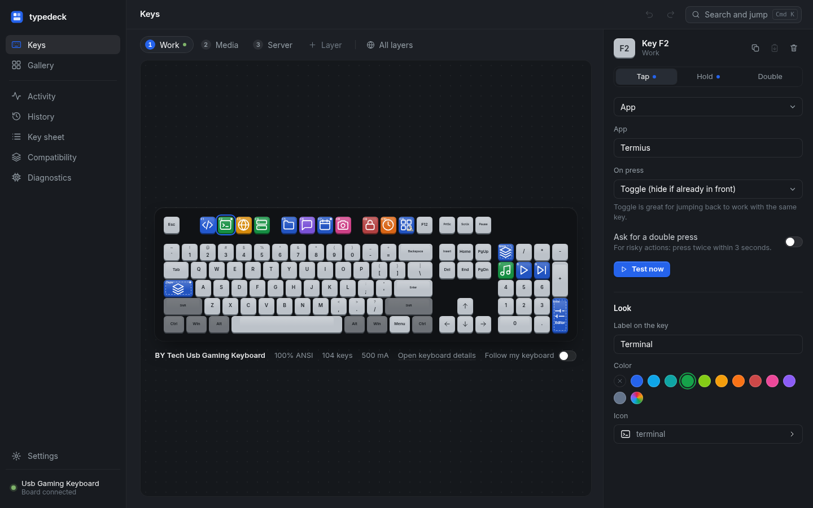
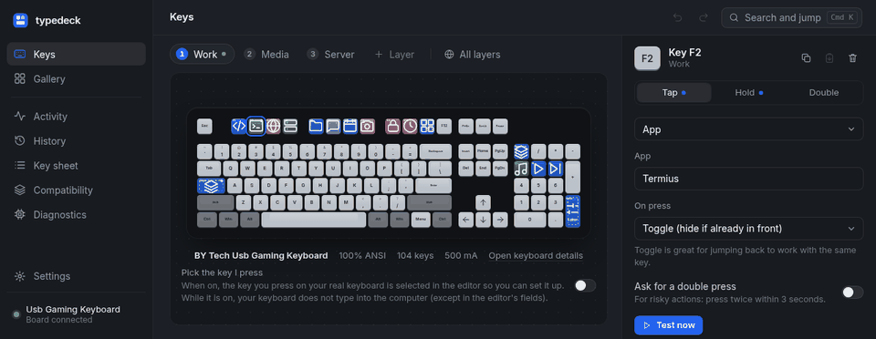
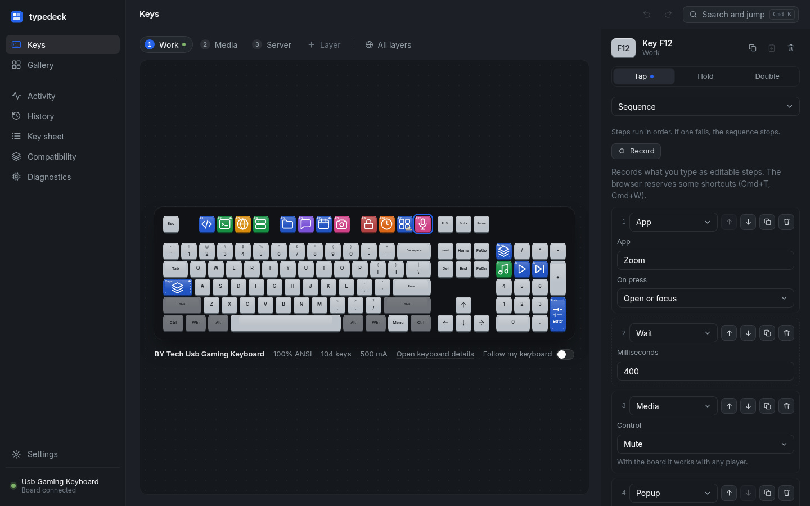
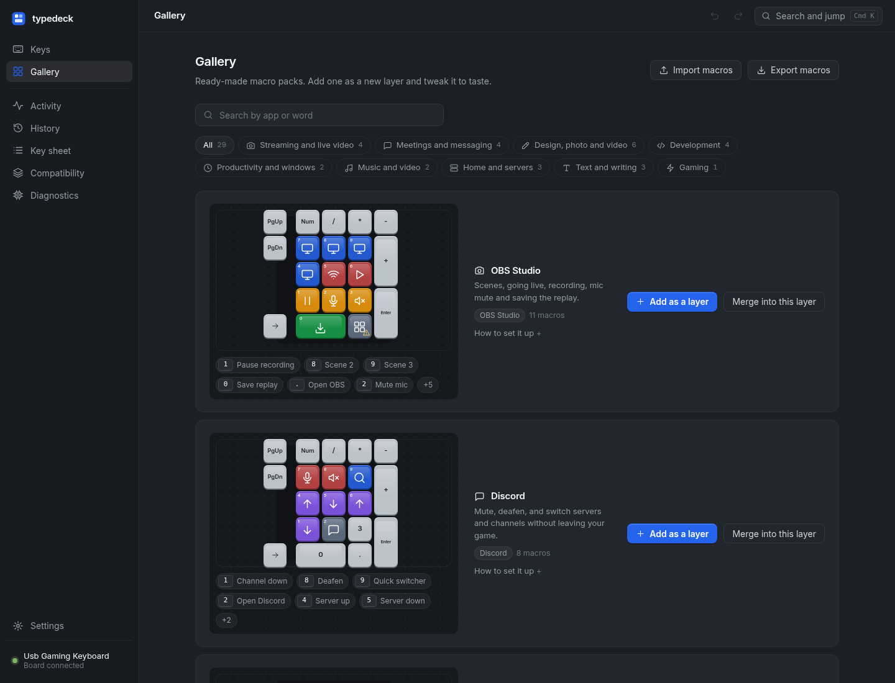
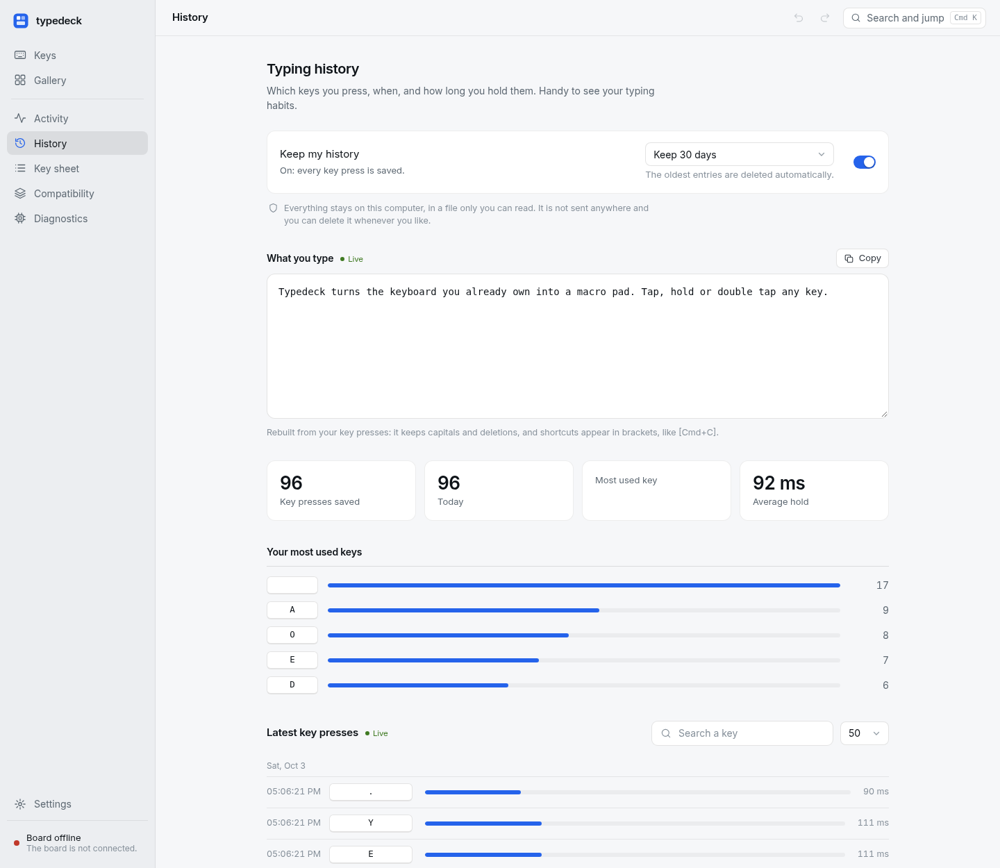
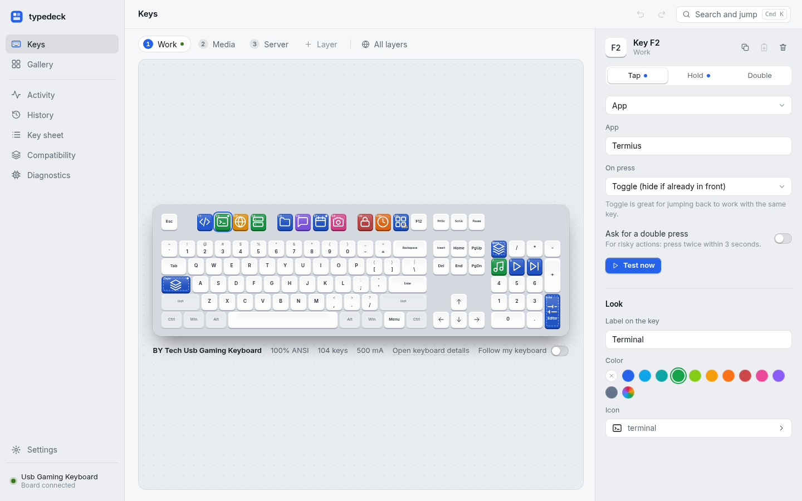
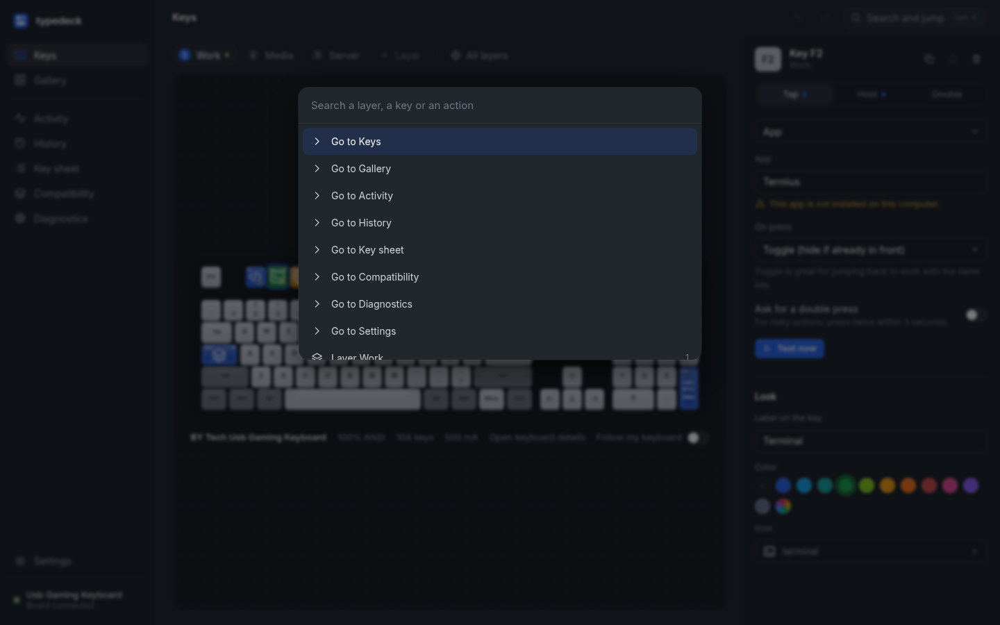
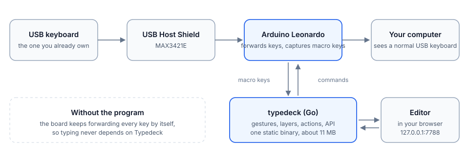

<div align="center">


# Typedeck

**Convierte el teclado que ya tienes en un teclado de macros.**

Cada tecla puede hacer más que escribir: pulsar, mantener o doble pulsación, capas, lanzadores de aplicaciones, comandos, SSH, textos, teclas multimedia, OBS Studio y más. Con una pequeña placa Arduino o sin ningún hardware.

[](https://github.com/cristobaltormo/typedeck/actions/workflows/ci.yml)
[](https://github.com/cristobaltormo/typedeck/releases)
[](LICENSE)
[](go.mod)
[](docs/COMPATIBILITY.md)

[Empezar](#empezar) · [Documentación](#documentación) · [Versiones](https://github.com/cristobaltormo/typedeck/releases) · [Cambios](CHANGELOG.md) · [English](README.md)

<br>



</div>

<br>

## Por qué

Los teclados de macros son un segundo aparato en la mesa, y la mayoría de herramientas de teclado solo funcionan en un sistema operativo. Typedeck pone las macros en el teclado en el que ya escribes, y está hecho para que escribir nunca dependa de él.

- **Tu propio teclado.** Una Arduino Leonardo pequeña con un USB Host Shield se coloca entre el teclado y el ordenador, deja pasar todas las teclas sin tocarlas y permite que cualquiera ejecute sus propias acciones. O sin hardware: en Windows, macOS y Linux Typedeck puede tomar las teclas [por software](#sin-placa) cuando tú lo activas.
- **Escribir es seguro.** Si el programa no está en marcha, o se cierra por un fallo, la placa sigue reenviando el teclado por su cuenta y cada tecla escribe su carácter de siempre. Con la captura por software, el gancho desaparece con el proceso.
- **Gestos y capas.** Pulsar, mantener y doble pulsación en cada tecla, cada uno con su acción. Hasta nueve capas con color, que se cambian con una tecla, mientras se mantiene una tecla o solas cuando una aplicación pasa al frente.
- **Quince tipos de acción.** Aplicación, enlace, comando, SSH, petición web, atajo, texto, secuencia, condición, multimedia, sistema, historial de tecleo, OBS Studio, temporizador, capa y aviso. La lista está en [docs/MACROS.md](docs/MACROS.md) (en inglés).
- **Graba y luego edita.** Teclea una secuencia y Typedeck la convierte en pasos, con tus pausas como pasos de espera que puedes reajustar, reordenar y duplicar.
- **Una galería de 38 paquetes** para OBS Studio, Discord, Zoom, Meet, Teams, Slack, Photoshop, Figma, Premiere, VS Code, Git, domótica, estudio y más, colocados en las teclas que tu teclado tiene de verdad.
- **Ligero.** Un solo binario estático de Go sin dependencias: unos 11 MB de RAM y nada de CPU en reposo, y unos 0,13 ms para reenviar una tecla dentro de la placa.
- **Privado por diseño.** El editor solo escucha en `127.0.0.1`, Typedeck no hace ninguna conexión de red por su cuenta, no tiene telemetría y no carga nada de internet. Mira [seguridad](docs/SECURITY.md).
- **macOS, Linux y Windows.** Las pruebas se ejecutan en los tres en cada subida.

## Capturas

Mueve un macro a otra tecla arrastrándolo; con Alt se copia en vez de mover.

<p align="center">
  
</p>

<table>
  <tr>
    <td width="50%"><br><b>Secuencias</b> con grabador, condiciones y pausas editables</td>
    <td width="50%"><br><b>Una galería</b> de paquetes colocados en las teclas que tu teclado tiene</td>
  </tr>
  <tr>
    <td><br><b>Historial de tecleo</b>, opcional y local, con lo que escribes en directo</td>
    <td><br><b>Claro y oscuro</b>, en inglés y español</td>
  </tr>
  <tr>
    <td colspan="2"><br><b>Paleta de comandos</b> para saltar a cualquier tecla, acción o ajuste</td>
  </tr>
</table>

## Cómo funciona

<p align="center">
  
</p>

La placa recoge el teclado del shield, reenvía sus informes al ordenador como un teclado USB normal y retira solo las teclas que tienen macro, enviándolas al programa por una línea serie. El programa decide qué hace cada gesto. Un latido cada segundo mantiene la captura; sin él, la placa deja de capturar a los 5 segundos. Más en [arquitectura](docs/ARCHITECTURE.md) (en inglés).

### Sin placa

La captura por software sustituye a la placa y está desactivada hasta que la eliges: el editor ofrece **Usar sin placa** cuando no aparece ninguna, y en Ajustes hay un interruptor para volver. Los gestos, las capas, las acciones y el editor son los mismos.

| Sistema | Cómo toma las teclas |
|---|---|
| Windows | un gancho de teclado de todo el sistema dentro del programa |
| macOS | `typedeck-capture`, un pequeño ayudante en Swift que el programa lanza y vigila, con un filtro de eventos |
| Linux | los dispositivos de entrada del núcleo: toma los teclados reales (`EVIOCGRAB`) y reemite lo que no toma por un teclado virtual (`/dev/uinput`), así X11 y Wayland se comportan igual |

Solo toma las teclas que tienen macro en la capa activa y deja pasar las demás sin que el programa las lea, salvo detectando teclas o con el historial de tecleo opcional activado. Un gancho ve todas las teclas, así que el editor te pide consentimiento antes, te dice qué hace y qué no, y lo registra en esa instalación: una copia de seguridad restaurada o un fichero importado no pueden activarla. Si el programa muere, cada tecla vuelve a escribir su carácter al instante. Es un trueque: no hay hardware que montar, pero hay límites que la placa no tiene (mira [Límites](#límites)). No la uses en un equipo compartido con otros usuarios.

## Cómo se compara

Typedeck hace una cosa: macros en el teclado que tienes, en cualquier escritorio. Los demás son la mejor opción en sus casos.

| | Typedeck | Teclados QMK o VIA | Stream Deck | AutoHotkey, Hammerspoon |
|---|---|---|---|---|
| Funciona con el teclado que ya tienes | sí | no, hace falta un teclado compatible con el firmware | no, es su propio panel | sí |
| Hardware que comprar | ninguno, o una Arduino y un shield | un teclado QMK | el panel | ninguno |
| macOS, Linux y Windows | los tres | cualquiera, corre en el teclado | Windows y macOS | uno cada uno |
| Editor visual | sí, en el navegador | VIA | sí | no, scripts |
| Escribir sigue si el programa muere | sí | sí | sí | depende del script |

## Qué necesitas

| Pieza | Notas |
|---|---|
| Arduino Leonardo (ATmega32U4) | probada con una Keystudio KS0248 |
| USB Host Shield 2.0 (MAX3421E) **con conector ICSP** | probado con uno Yanmis |
| Un teclado USB con cable | hasta 500 mA |
| macOS 12 o posterior, Linux (X11 o Wayland) o Windows 10 y 11 | mira [compatibilidad](docs/COMPATIBILITY.md) para saber qué está probado dónde |

Apila el shield sobre la Leonardo, enchufa el teclado al shield y la Leonardo al ordenador. Detrás de un conmutador KVM o de un hub, lee antes [hardware](docs/HARDWARE.md). Sin placa sirve cualquier teclado, con cable, inalámbrico o el del portátil.

## Empezar

### 1. Instalar

En Debian, Ubuntu y Fedora, descarga el `.deb` o el `.rpm` de tu arquitectura de la [página de versiones](https://github.com/cristobaltormo/typedeck/releases):

```sh
sudo apt install ./typedeck_<version>_amd64.deb      # o: sudo dnf install ./typedeck-<version>-1.x86_64.rpm
```

En macOS y en el resto de Linux, descarga el archivo o el binario suelto:

```sh
curl -L -o typedeck https://github.com/cristobaltormo/typedeck/releases/latest/download/typedeck-linux-amd64
chmod +x typedeck
```

En Windows, en PowerShell:

```powershell
Invoke-WebRequest https://github.com/cristobaltormo/typedeck/releases/latest/download/typedeck-windows-amd64.exe -OutFile typedeck.exe
```

Hay versiones para Linux (amd64, arm64), macOS (Intel y Apple silicon) y Windows (amd64 y arm64), cada una con su suma en `SHA256SUMS` y una atestación de procedencia. O compílalo: `go install github.com/cristobaltormo/typedeck/cmd/typedeck@latest`.

### 2. Grabar la placa (una vez; sin placa, sáltalo)

Cada versión adjunta el firmware ya hecho y `arduino-cli` lo sube en cualquier sistema:

```sh
arduino-cli core install arduino:avr
arduino-cli upload --fqbn arduino:avr:leonardo --port <puerto> --input-file typedeck-firmware-15.hex
```

### 3. Ponerlo en marcha

```sh
typedeck doctor     # comprueba la configuración, las herramientas del sistema, el puerto, la placa y el teclado
typedeck            # arranca el programa; el editor está en http://127.0.0.1:7788
typedeck install    # arrancar con tu sesión (typedeck uninstall lo quita)
```

La primera pantalla del editor te guía por el teclado que ha encontrado y su distribución. Los detalles de cada sistema, los permisos en macOS, el grupo `input` en Linux, el icono de la zona de notificaciones en Windows y todo lo demás están en [docs/INSTALL.md](docs/INSTALL.md) (en inglés).

## Seguro por diseño

- Las teclas solo se toman del teclado mientras el programa está vivo. Si se para, cada tecla vuelve a escribir en menos de 5 segundos con la placa, y al instante con la captura por software.
- El editor solo escucha en `127.0.0.1`, cada petición necesita un token generado en cada arranque, y un fichero de macros que importas se valida y se te muestra antes de añadirlo. [docs/SECURITY.md](docs/SECURITY.md) tiene el modelo y [SECURITY.md](SECURITY.md) cómo avisar de un problema.
- Sin el historial de tecleo opcional, el programa solo ve las teclas que tienen macro.

## Rendimiento

| Qué | Resultado |
|---|---|
| Reenviar un informe de teclado dentro de la placa | unos 0,13 ms |
| Memoria del programa en reposo | unos 11 MB, 0 % de CPU |
| Primera carga del editor | unos 100 KB, sin framework |

Cómo medir tu propia instalación está en [docs/PERFORMANCE.md](docs/PERFORMANCE.md).

## Límites

- **Placa:** seis teclas simultáneas y sin reenvío del ratón ni de las teclas de sistema integradas del teclado.
- **Windows sin placa:** las ventanas que corren como administrador y la pantalla UAC quedan fuera del alcance del gancho de un usuario normal, y el antitrampas de algunos juegos trata cualquier gancho global como sospechoso. Usa la placa para esos juegos.
- **macOS sin placa:** los campos de contraseña (entrada segura) quedan ocultos a toda herramienta de teclado, el ayudante necesita Accesibilidad y Monitorización de entrada, y no ve el teclado con la pantalla bloqueada.
- **Linux sin placa:** necesita el grupo `input`, funciona por debajo del escritorio y por eso también ve la pantalla de bloqueo, y si el programa se congela en vez de morir, los teclados tomados esperan a que vuelva.

Cada límite con su motivo y qué hacer está en [docs/LIMITS.md](docs/LIMITS.md) (en inglés).

## Documentación

| | |
|---|---|
| [Instalar y configurar](docs/INSTALL.md) | cada sistema, permisos, arrancar con la sesión |
| [Macros](docs/MACROS.md) | cada tipo de acción, gestos, capas y condiciones |
| [Hardware](docs/HARDWARE.md) | la placa, el shield, alimentación, KVM, grabado |
| [Compatibilidad](docs/COMPATIBILITY.md) | qué está probado dónde |
| [Límites](docs/LIMITS.md) | lo que no puede hacer cada modo de captura |
| [Seguridad](docs/SECURITY.md) | el modelo, qué está protegido y qué no |
| [Arquitectura](docs/ARCHITECTURE.md) y [protocolo serie](docs/PROTOCOL.md) | cómo funciona por dentro |
| [Rendimiento](docs/PERFORMANCE.md) | cifras y cómo medirlas |
| [Problemas](docs/TROUBLESHOOTING.md) y [FAQ](docs/FAQ.md) | cuando algo no funciona |
| [Ejemplos](examples) | paquetes de macros para importar |

La documentación detallada está en inglés.

## Contribuir

Un informe de error con la salida de `typedeck doctor` es lo más útil que puedes mandar; las pull requests son bienvenidas. Mira [CONTRIBUTING](CONTRIBUTING.md) y el [código de conducta](CODE_OF_CONDUCT.md). Para avisar de una vulnerabilidad, lee la [política de seguridad](SECURITY.md). Todo se comprueba con:

```sh
make check
```

## Licencia

El programa, el editor y la documentación son MIT, mira [LICENSE](LICENSE). El firmware de `firmware/` se compila con la USB Host Shield Library 2.0 y por eso es GPL-2.0, mira [NOTICE](NOTICE).
