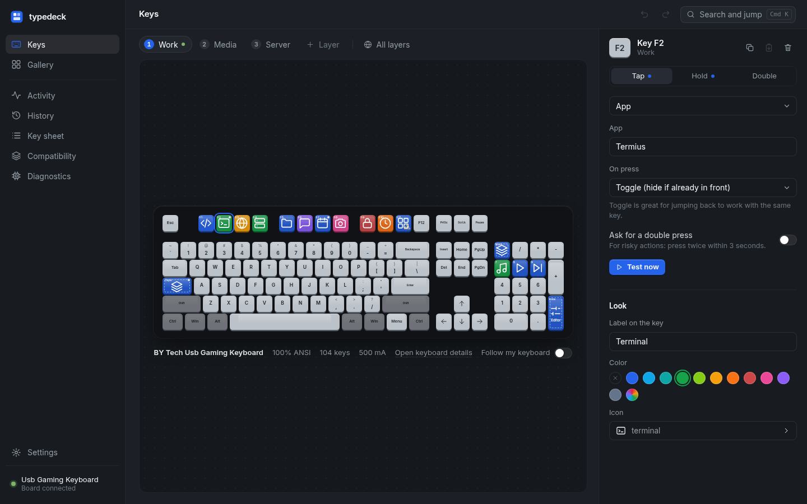
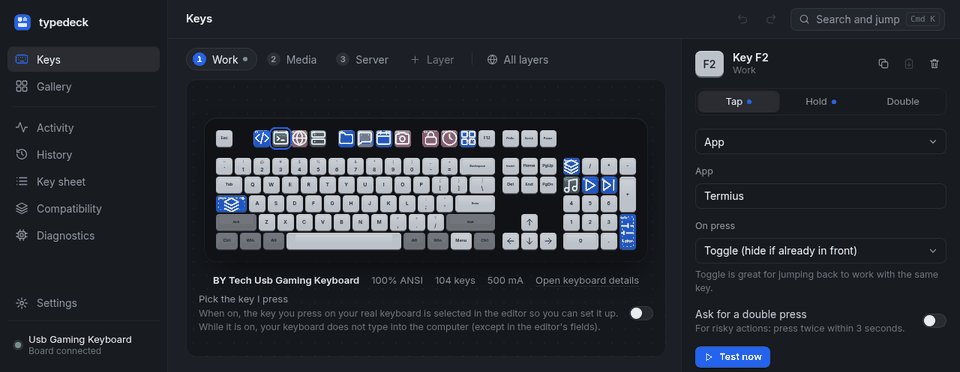
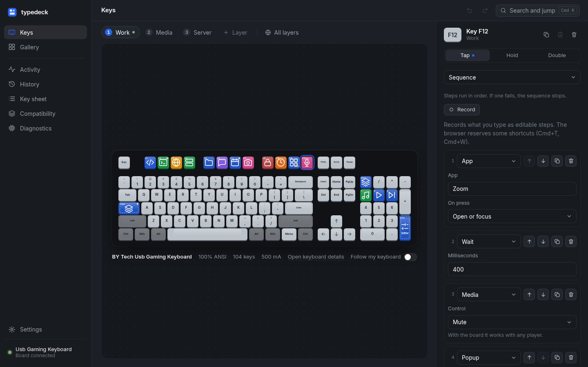
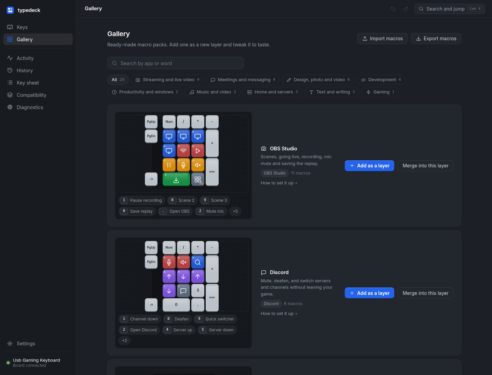
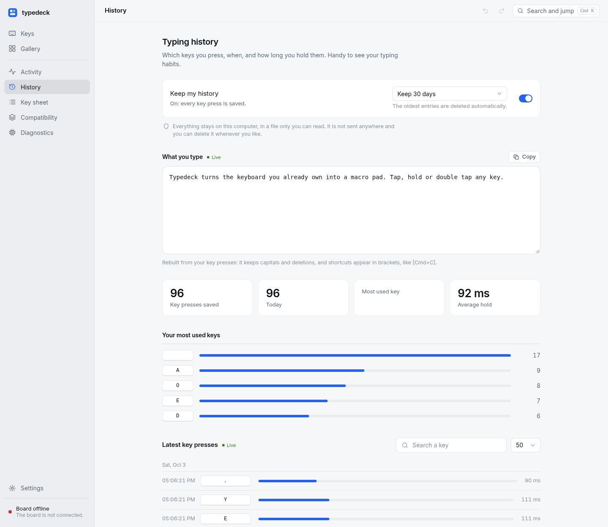
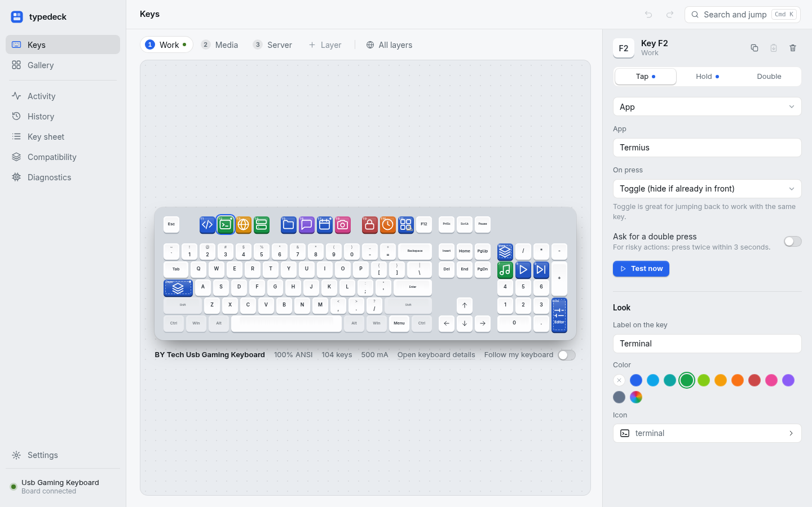
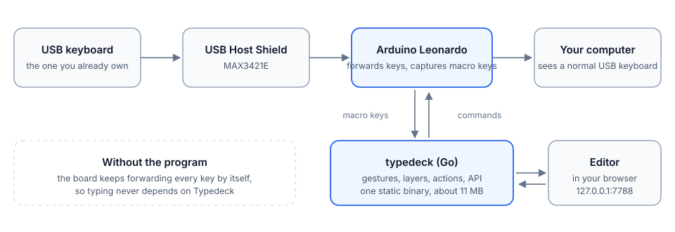

# Typedeck

English | [Español](README.es.md)

[](https://github.com/cristobaltormo/typedeck/actions/workflows/ci.yml)
[](https://github.com/cristobaltormo/typedeck/releases)
[](LICENSE)
[](go.mod)
[](docs/COMPATIBILITY.md)

Turn the USB keyboard you already own into a macro keyboard. A small Arduino Leonardo with a USB Host Shield sits between the
keyboard and the computer, passes every key through untouched, and lets any key run its own actions: tap, hold or double tap,
layers, app launchers, shell commands, SSH, text snippets, media keys, OBS Studio and more.

Typing never depends on the software. If the program is not running, or crashes, the board keeps forwarding the keyboard on its
own and every key types its own character.

No board yet? On Windows, macOS and Linux, Typedeck can take the keys in software instead, with a keyboard hook (Windows), a small helper that filters keyboard events (macOS) or the kernel's input devices (Linux) that you turn on yourself. It is a
trade: no hardware to build, but a few limits that the board does not have (see [Limits](#limits)).

Typedeck is a single static Go binary with no dependencies. Idle it uses about 11 MB of RAM and no CPU, and forwarding a key
takes about 0.13 ms inside the board. It runs on macOS, Linux and Windows, and its tests run on the three on every push.



Move a macro to another key by dragging it; Alt copies instead of moving.



## What it looks like

The editor opens in your browser, on your own computer. Pick a key on the drawing of your real keyboard and give it an action.

| | |
|---|---|
|  **Sequences** with a recorder, conditions and editable pauses |  **A gallery** of packs laid out on the keys your keyboard really has |
|  **Typing history**, optional and local, with what you type shown live |  **Light and dark**, English and Spanish |

## How it works



The board takes the keyboard on the shield, forwards its reports to the computer as a normal USB keyboard, and removes only the keys
that have a macro, sending them to the program over a serial line instead. The program decides what each gesture does. A heartbeat
every second keeps capture on; without it, the board stops capturing after 5 seconds. More in
[docs/ARCHITECTURE.md](docs/ARCHITECTURE.md).

**Without a board (Windows, macOS and Linux).** Software capture replaces the board with a system-wide keyboard hook, in the same program
on Windows, and with `typedeck-capture` on macOS: a small Swift helper that the program starts and watches, which installs an event
tap and talks to the program through plain text lines on its standard input and output. The hook or the tap
takes only the keys that have a macro on the active layer and lets every other key through without the program reading it
(unless you are detecting keys or you turned the optional history on, which records what you type in every application). Gestures, layers, actions and the editor are the same. It
is off until you choose it: the editor offers **Use without a board** when no board shows up, and Settings has a switch to go back.
A hook sees every key, so the editor asks for your consent first, says what it does and does not do, and records the consent on that installation: a restored backup or an imported file cannot turn it on. Do not use it on a computer shared with other users: the editor listens on a port every local user shares. If the program dies the
hook dies with it and every key types its own character again; on macOS the helper notices that the program is gone and exits,
which removes the tap.

On Linux there is no hook to install, so software capture works below the desktop: it opens the real keyboards in `/dev/input`,
takes each one exclusively (`EVIOCGRAB`) and sends every key it does not take, modifiers, auto-repeat and media keys included,
back through a virtual keyboard of its own (`/dev/uinput`); the keyboard LEDs are passed back the other way. Because it sits under
the compositor, X11 and Wayland behave the same. The kernel releases the grab when the program's file descriptors close, so if the
program dies every key types again at once. It needs your user in the `input` group and the `uinput` module: the `.deb` and `.rpm`
packages install the udev rule and load the module, you add yourself to the group.

## What you need

| Part | Notes |
|---|---|
| Arduino Leonardo (ATmega32U4) | tested with a Keystudio KS0248 |
| USB Host Shield 2.0 (MAX3421E) **with an ICSP header** | tested with a Yanmis |
| A wired USB keyboard | up to 500 mA |
| macOS 12 or newer, Linux (X11 or Wayland) or Windows 10 and 11 | see [compatibility](docs/COMPATIBILITY.md) for what is tested where |

Stack the shield on the Leonardo, plug the keyboard into the shield and the Leonardo into the computer. Behind a KVM switch or a
hub, read [docs/HARDWARE.md](docs/HARDWARE.md) first.

On Windows 10 and 11, on macOS 12 or newer and on Linux the board and its shield are optional: with software capture any keyboard works,
wired, wireless or the laptop's own. On macOS it needs the `typedeck-capture` helper next to the program and two permissions you
give it (Accessibility and Input Monitoring). On Linux it needs access to `/dev/input` and `/dev/uinput` (see [Troubleshooting](docs/TROUBLESHOOTING.md#software-capture-on-linux-says-it-is-not-running)).

## Install

On Debian, Ubuntu and Fedora, download the `.deb` or `.rpm` for your architecture from the
[releases page](https://github.com/cristobaltormo/typedeck/releases). It installs the program, the udev rule that lets your user open the
board, and the firmware sketch:

```sh
sudo apt install ./typedeck_<version>_amd64.deb      # or: sudo dnf install ./typedeck-<version>-1.x86_64.rpm
```

Everywhere else, download the archive or the plain binary for your machine from the same page:

```sh
curl -L -o typedeck https://github.com/cristobaltormo/typedeck/releases/latest/download/typedeck-linux-amd64
chmod +x typedeck
```

On Windows, in PowerShell:

```powershell
Invoke-WebRequest https://github.com/cristobaltormo/typedeck/releases/latest/download/typedeck-windows-amd64.exe -OutFile typedeck.exe
```

The `typedeck-cli-windows-amd64.exe` next to it is the same program for terminals (see Set it up below); the zip archives have both.

There are builds for Linux (amd64, arm64), macOS (Intel and Apple silicon) and Windows (amd64 and arm64), each with a checksum in
`SHA256SUMS` and a build provenance attestation (`gh attestation verify <file> --repo cristobaltormo/typedeck`). To build it yourself you need Go 1.24 or newer:

```sh
go install github.com/cristobaltormo/typedeck/cmd/typedeck@latest
```

Flash the board once. Each release attaches the ready-made firmware, `typedeck-firmware-<number>.hex`, and `arduino-cli` uploads it on
Windows, Linux and macOS alike:

```sh
arduino-cli core install arduino:avr
arduino-cli upload --fqbn arduino:avr:leonardo --port <port> --input-file typedeck-firmware-15.hex
```

Stop Typedeck first and see [docs/HARDWARE.md](docs/HARDWARE.md#flashing) for the port names and the steps. To compile the firmware
yourself it needs the two libraries it uses ([firmware/README.md](firmware/README.md)).

## Set it up

```sh
typedeck doctor     # checks the configuration, the OS tools, the port, the board and the keyboard
typedeck            # starts the program; the editor is at http://127.0.0.1:7788
typedeck install    # start with your session (typedeck uninstall removes it)
```

- **macOS:** `typedeck install` creates a launch agent that starts it when you sign in. The on-screen popup is a small Swift helper:
  `swiftc -O macos/hud/hud.swift -o typedeck-hud`, placed next to the `typedeck` binary. The macOS archive already contains both
  helpers (`typedeck-hud` and `typedeck-capture`, universal and ad-hoc signed); `make macos-helpers` builds them on a Mac with the
  Xcode command line tools. Archives downloaded with a browser carry a quarantine mark that blocks unsigned helpers:
  `xattr -dr com.apple.quarantine <folder>` once. Software capture asks for **Accessibility** and **Input Monitoring** for
  `typedeck-capture` the first time you turn it on (never before); if you miss the prompt, add it by hand in System Settings, Privacy
  & Security, with the `+` button, choosing the file next to `typedeck`. `typedeck doctor` says which one is missing.
- **Linux:** copy `packaging/linux/70-typedeck.rules` to `/etc/udev/rules.d/` so your user can open the board without the `dialout`
  group. Install `xdg-utils` and `libnotify-bin`; `xdotool` (X11) or `wtype` (Wayland) only matter when the board is not connected.
  Logs: `journalctl --user -u typedeck`.
- **Windows:** double click `typedeck.exe` to start it: it opens the editor in your browser and puts an icon in the notification area
  (Open editor, status, Restart, Quit). Opening it again only opens the editor of the copy that is already running.
  `typedeck.exe install` makes it start when you sign in, with a scheduled task that has no time limit, also runs on battery and
  starts no second copy; if Windows does not let a standard user create it, it falls back to the `Run` key of your account.
  `typedeck.exe uninstall` stops it in an orderly way and removes both. The archive also has `typedeck-cli.exe`, the same program built
  for terminals: use it for `doctor`, `install` and `uninstall` from cmd or PowerShell so the output is shown in place and the exit code
  is reliable. Logs: `%LOCALAPPDATA%\typedeck\typedeck.log`. Locking the screen or suspending releases the captured keys and they are
  captured again when you return. The program is not code signed (a certificate costs money), so see
  [Windows blocks the executable](docs/TROUBLESHOOTING.md#windows-blocks-the-executable).

Set `TYPEDECK_PORT=/dev/ttyACM1` (or `COM5`) when the board is on an unusual port. The first screen of the editor walks you through
the keyboard it found and its layout.

## What it can do

- **Gestures and layers.** Tap, hold and double tap on every key, each with its own action. Up to nine layers with a color, switched
  by a key, momentarily while a key is held, or automatically when an application comes to the front.
- **Fifteen kinds of action.** Application (open, toggle, quit), link, command, SSH, web request, shortcut, text, sequence,
  condition, media, system, typing history, OBS Studio, timer, layer and popup. The full list is in [docs/MACROS.md](docs/MACROS.md).
- **Record, then edit.** Type a sequence and Typedeck turns it into steps, with your pauses as wait steps you can retime, reorder
  and duplicate.
- **Conditions.** Run one list of steps or another depending on the front application, the active layer, the time of day, the
  system, whether OBS is live or recording, or what the clipboard holds.
- **Share macros as files.** Export a layer or everything; importing shows every command and web request in a file before anything
  is added. [examples/](examples) has packs to start from.
- **A gallery of 38 packs** for OBS Studio, Discord, Zoom, Meet, Teams, Slack, Photoshop, Figma, Premiere, VS Code, Git, smart
  home, study and more, laid out on the keys your keyboard has.
- **The whole keyboard, not a separate pad.** It detects the keyboard (brand, model, USB details) and draws it with its real format,
  100 to 60 percent, ISO or ANSI. A key assistant works the layout out when the keyboard does not say.
- **No permissions to type.** Shortcuts, text and media keys leave the board as real USB keystrokes: no Accessibility permission on
  macOS, no `xdotool` on Linux. Remapped modifiers and ISO/ANSI quirks on a
  Mac are compensated, and Spanish text uses the right layout and Alt Gr on each system.
- **OBS Studio without hotkeys.** Scenes, going live, recording, muting the mic or saving the replay through OBS's own WebSocket
  server.
- **Live editor.** Every key lights up on the drawing as you press it, a popup warns you when the board stops seeing the keyboard,
  and the key that opens the editor focuses the tab that is already open.
- **Typing history, optional.** Off by default. A page with what you type shown as text, totals, your most used keys and the latest
  presses, stored in a local file with the oldest entries deleted automatically and a switch you can put on a key. It never leaves
  your computer.
- **Everything around it.** Compatibility page with automatic checks, activity log and per-key usage, searchable and printable key
  sheet, diagnostics, command palette, undo and redo, automatic backups.

## Safe by design

- Keys are only taken from the keyboard while the program is alive. If it stops, every key types again within 5 seconds with the
  board, and at once with software capture (the hook, the tap or the grab disappears with the process).
- The editor listens only on `127.0.0.1`, every request needs a token generated on each start, and a macro file you import is
  validated and shown to you before it is added. [docs/SECURITY.md](docs/SECURITY.md) has the model, and [SECURITY.md](SECURITY.md)
  how to report a problem.
- Typedeck makes no network connection of its own, has no telemetry and loads nothing from the internet.
- Without the optional typing history, the program only sees the keys that have a macro (with the board, an open editor also shows the keys you press, without storing them; with software capture it does not).

## Performance

| What | Result |
|---|---|
| Forwarding one keyboard report inside the board | about 0.13 ms |
| Program memory when idle | about 11 MB, 0 % CPU |
| First load of the editor | about 100 KB, no framework |

Details and how to measure your own setup are in [docs/PERFORMANCE.md](docs/PERFORMANCE.md).

## Documentation

[Macros](docs/MACROS.md) · [FAQ](docs/FAQ.md) · [Compatibility](docs/COMPATIBILITY.md) · [Architecture](docs/ARCHITECTURE.md) ·
[Serial protocol](docs/PROTOCOL.md) · [Hardware and power](docs/HARDWARE.md) · [Security](docs/SECURITY.md) ·
[Performance](docs/PERFORMANCE.md) · [Troubleshooting](docs/TROUBLESHOOTING.md) · [Changelog](CHANGELOG.md) ·
[Contributing](CONTRIBUTING.md)

## Limits

With the board: six simultaneous keys (boot protocol, confirmed on the real keyboard) and no forwarding of the keyboard's built-in
mouse or system keys. Behind a KVM switch the keyboard can go missing after a power cut; the firmware recovers it by itself in under a minute and
[Hardware](docs/HARDWARE.md) explains how to avoid it.

Without the board (Windows software capture):

- Windows does not show the hook keys typed into windows running as administrator or the UAC screen while Typedeck runs as a normal
  user, so macros do not work there. Running Typedeck as administrator lifts this for administrator windows, not for UAC.
- The anti-cheat of some games treats any global keyboard hook as suspicious and may refuse to start or flag it. Use the board for
  those games.
- The hook runs inside the computer, so the delay is higher than the 0.13 ms of the board (microseconds in the hook itself, plus the
  scheduling of the program). If the program freezes or is stopped, keys that have a macro type their own character until it is back.
- The limit of six simultaneous keys does not apply. Media keys, the keyboard's built-in system keys and keys of other keyboards are
  not captured, only the keys of the standard keyboard report.
- It sees the keys that have a macro, plus every key while detecting keys or with the typing history on; nothing
  else, and nothing leaves the computer. See [docs/SECURITY.md](docs/SECURITY.md).

Without the board (macOS software capture):

- macOS hides what you type into password fields (secure input) from every keyboard tool, so macros do not run there, and it
  stops showing keys to a tap while the screen is locked.
- It needs two permissions for the helper, Accessibility and Input Monitoring, and macOS may withdraw a tap that is too slow or after
  sleep; the helper turns it back on by itself and releases the keys it held.
- Caps Lock reaches a tap as a toggle, not as a key you can hold, so as a layer key it behaves as a tap; on the board it is a true
  held key. This comes from how macOS delivers it and has not been tried on a real keyboard yet.
- Typedeck sends its own keys with `CGEventPost` and media keys as system events; Caps Lock is switched through the HID system, so
  the short-press problem of the board does not apply.
- It sees only the keys that have a macro, plus every key while detecting keys or with the typing history on;
  the helper never sends anything else to the program and nothing leaves the computer. See [docs/SECURITY.md](docs/SECURITY.md).

Without the board (Linux software capture):

- It needs read access to every keyboard and permission to create a virtual one, which in practice means being in the `input`
  group. Anything running as a member of that group can read the keyboards, so see [docs/SECURITY.md](docs/SECURITY.md) before
  turning it on on a shared computer.
- It works below the desktop, so it also sees the lock screen and other virtual terminals: a macro can run while the screen is
  locked. Typedeck does not detect the lock.
- While it is on, the program is in the path of every key of the grabbed keyboards. If it dies, the kernel gives the keyboards back
  at once (tested with `kill -9`), but if it is frozen and not dead (`SIGSTOP`, a debugger) those keyboards do not respond until it
  resumes or you close it with the mouse or over ssh. Typedeck ignores `SIGTSTP`, so Ctrl+Z in the terminal that started it does not
  freeze it.
- The virtual keyboard replaces your keyboards for the desktop, so settings that match a keyboard by name (per-device layouts in
  Sway, for instance) must also match `Typedeck virtual keyboard`. Devices with a pointer in the same node, and nodes with no letter
  keys (media keys, power button, lid), are left alone.
- The virtual keyboard declares the keyboard keys 1 to 255 and 0x160 to 0x2BF (media and function keys such as `KEY_FN`), but not the
  button codes 0x100 to 0x15F or 0x2C0 and above, because declaring those makes the kernel and udev treat it as a mouse or a joystick;
  a key sent with one of those codes is not re-emitted. The ioctl numbers assume the generic Linux layout (x86, ARM, RISC-V), not MIPS or
  PowerPC. Text that the keyboard layout cannot type goes through the clipboard (`wl-copy` or `xclip` or `xsel`) and Ctrl+V.
- Delay: about 60 microseconds more at the median than a direct read (measured on a virtual machine, see
  [docs/PERFORMANCE.md](docs/PERFORMANCE.md)); idle it uses no CPU.


## Contributing

Bug reports with the output of `typedeck doctor` are the most useful thing you can send; pull requests are welcome.
[CONTRIBUTING.md](CONTRIBUTING.md) has the setup and the rules, and everything is checked with `make check`.

## Privacy

Typedeck makes no network connection of its own and sends no data anywhere; the editor listens on `127.0.0.1` only.

## License

The program, the editor and the documentation are MIT licensed, see [LICENSE](LICENSE). The firmware in `firmware/` is built with
the USB Host Shield Library 2.0 and is therefore GPL-2.0, see [NOTICE](NOTICE).
